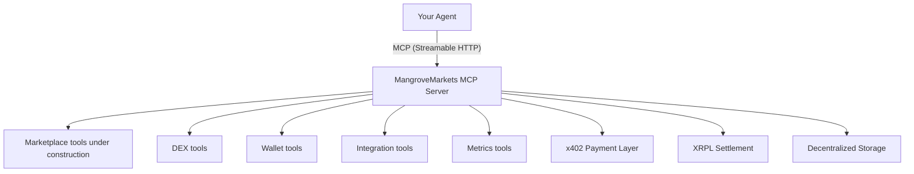
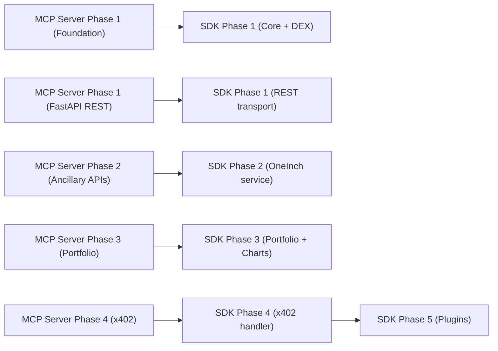

# MangroveMarkets SDKs

[](https://discord.gg/xUcn4R6zJR)

Clients for MangroveMarkets DEX aggregation, wallet workflows and hosted Kraken
OAuth account access. Agent-to-agent marketplace products, listings, offers and
escrow are under construction.

## Choose a product and language

| Product | Python | TypeScript | Use it for |
| --- | --- | --- | --- |
| **MangroveMarkets** (this repo) | [`mangrovemarkets` 1.1.1](https://pypi.org/project/mangrovemarkets/1.1.1/), import `mangrove_markets` | [`@mangrove-ai/sdk` 0.3.0](https://www.npmjs.com/package/@mangrove-ai/sdk/v/0.3.0) is published; 0.4.0 is source-only | Markets DEX, wallet and venue account workflows; check version-specific capabilities below. |
| **MangroveAI** ([separate SDK repo](https://github.com/MangroveTechnologies/MangroveAI-SDK)) | [`mangroveai` 2.1.0](https://pypi.org/project/mangroveai/2.1.0/), import `mangrove_ai` | `@mangrove-ai/client` 0.1.0 is implemented in [source](https://github.com/MangroveTechnologies/MangroveAI-SDK/tree/main/packages/typescript), not published on npm | AI strategy, backtesting and execution APIs. |

The `@mangrove-ai` npm scope contains distinct products. The existing
`@mangrove-ai/sdk` name belongs to **MangroveMarkets** and remains compatible.
Registry checkpoint: November 1, 2026 (America/Chicago). See the [capability and release
matrix](docs/markets-sdk-capability-matrix.md) for source versus published coverage.

## What Is This?

This repo contains the **client-side packages** for MangroveMarkets:

| Package | Path | Description |
|---------|------|-------------|
| **Python SDK** | `packages/python-sdk` | `mangrovemarkets` -- published Python Markets client |
| **TypeScript SDK** | `packages/sdk` | `@mangrove-ai/sdk` -- typed client for MCP server + REST API |
| **Claude Plugin** | `packages/claude-plugin` | `@mangrove-ai/claude-plugin` -- private source package, unpublished |
| **OpenClaw Plugin** | `packages/openclaw-plugin` | `@mangrove-ai/openclaw-plugin` -- private source package, unpublished |
| **Website** | `packages/website` | Next.js marketing site for mangrovemarkets.com |

For the **MCP server** (backend), see [MangroveMarkets-MCP-Server](https://github.com/MangroveTechnologies/MangroveMarkets-MCP-Server).

## How It Works



## Quick Start

### Python Markets SDK

Published package: `mangrovemarkets` 1.1.1. The import is `mangrove_markets`.

```bash
pip install mangrovemarkets==1.1.1
```

```python
import os
from mangrove_markets import MangroveMarkets

# Replace with the API origin confirmed by your Markets deployment owner.
markets_api_origin = "https://markets-api.example"
with MangroveMarkets(
    base_url=markets_api_origin,
    api_key=os.environ["MANGROVE_API_KEY"],
) as markets:
    print(markets.dex.supported_venues())
```

See the [Python Markets guide](packages/python-sdk/README.md).

### TypeScript Markets SDK

At the November 1 registry checkpoint, npm published **0.3.0** and source
**0.4.0 was unpublished**. Verify the installed version before using 0.4.0
examples; its Kraken OAuth, full-result and local-wallet additions are not in
0.3.0. The older 0.3.0 wallet method uses the hosted-wallet path.

```bash
pnpm add @mangrove-ai/sdk
```

```typescript
import { MangroveClient as MangroveMarketsClient } from "@mangrove-ai/sdk";

// Replace with the API origin confirmed by your Markets deployment owner.
const marketsApiOrigin = "https://markets-api.example";
const markets = new MangroveMarketsClient({
  url: marketsApiOrigin,
  apiKey: process.env.MANGROVE_API_KEY,
  transport: "rest",
});
await markets.connect();
console.log(await markets.dex.supportedVenues());
await markets.disconnect();
```

See the [TypeScript Markets guide](packages/sdk/README.md) for version-specific
capabilities. These examples make read requests; they do not sign, fund or place
an order and do not establish live funded acceptance.

### Using both Python products

Pass each product's base explicitly. Both clients otherwise read
`MANGROVE_BASE_URL`, but **Markets expects an origin** and appends `/api/v1`,
while **MangroveAI expects its versioned `/api/v1` API base**. The local variable
names below are examples, not additional SDK environment-variable settings.

```python
from mangrove_markets import MangroveMarkets
from mangrove_ai import MangroveAI

markets_api_origin = "https://markets-api.example"
ai_api_base = "https://ai-api.example/api/v1"
markets = MangroveMarkets(base_url=markets_api_origin, api_key=markets_api_key)
ai = MangroveAI(base_url=ai_api_base, api_key=ai_api_key, load_dotenv=False)
```

`markets_api_key` and `ai_api_key` come from your private configuration. The
marketing website `mangrovemarkets.com` is not a substitute for an API origin.

### Using the MCP SDK Directly

```typescript
import { Client } from "@modelcontextprotocol/sdk/client/index.js";
import { StreamableHTTPClientTransport } from "@modelcontextprotocol/sdk/client/streamableHttp.js";

const marketsApiOrigin = "https://markets-api.example"; // deployment-owner-confirmed origin
const marketsApiKey = process.env.MANGROVE_API_KEY; // private process configuration
if (!marketsApiKey) throw new Error("Configure the Markets API key");
const client = new Client({ name: "my-agent", version: "1.0.0" });
const transport = new StreamableHTTPClientTransport(
  new URL(`${marketsApiOrigin}/mcp`),
  { requestInit: { headers: { Authorization: `Bearer ${marketsApiKey}` } } }
);
await client.connect(transport);

const result = await client.callTool({
  name: "dex_get_quote",
  arguments: { input_token: "USDC", output_token: "ETH", amount: 1000000000, chain_id: 8453 },
});
```

### Plugin source

The [Claude plugin](packages/claude-plugin) and [OpenClaw plugin](packages/openclaw-plugin)
are private, unpublished workspace packages. They are source integrations, not
npm installation targets. Their marketplace skills do not make the marketplace
workflows available.

## Documentation

### Start Here

| Document | Purpose |
|----------|---------|
| **[Product Roadmap](https://github.com/MangroveTechnologies/MangroveMarkets-MCP-Server/blob/main/docs/plans/2026-02-28-mangrove-roadmap-design.md)** | High-level roadmap: 4 phases, work streams, completion criteria |
| [SDK Design](docs/plans/2026-02-23-client-sdk-design.md) | SDK architecture: transports, signer interface, API surface |
| [Plugins Design](docs/plans/2026-02-28-plugins-design.md) | Claude Plugin + OpenClaw Plugin architecture |

### Implementation Plans

Task-by-task TDD plans with exact file paths, complete code, and test commands.

| Implementation Plan | Work Stream | Tasks |
|--------------------|-------------|-------|
| [SDK Implementation Plan](docs/plans/2026-02-24-client-sdk-plan.md) | E | 19 tasks, 5 phases |
| [Plugins Implementation Plan](docs/plans/2026-03-01-plugins-plan.md) | F | 13 tasks |

### Reference

| Document | Purpose |
|----------|---------|
| [Vision](docs/vision.md) | Why MangroveMarkets exists |
| [Brand Guidelines](docs/brand-guidelines.md) | Visual identity |
| [CONTRIBUTING.md](CONTRIBUTING.md) | Development workflow, branching, PR process |
| [AGENTS.md](AGENTS.md) | Agent conventions, domain boundaries |

## Roadmap

This repo delivers **SDK and Plugins** that evolve with every phase of the server.

| Phase | Chain | SDK Additions | Plugin Additions |
|-------|-------|---------------|-----------------|
| 1 | Base (EVM) | MCP + REST transport, EthersSigner, DEX swap orchestration, marketplace client | /swap, /marketplace, /wallet, /portfolio skills; OpenClaw tools + dashboard |
| 2 | XRPL | XRPL signer adapter, escrow monitoring | XRPL swap, escrow, wallet ops |
| 3 | Solana | Solana signer adapter | Jupiter swap, Solana wallet ops |
| 4 | All | Cross-chain convenience methods | Metrics dashboard, portfolio views |

### How Phases Connect to the Server

The SDK wraps the MCP server's tools. Server-side work streams (A-D) must deliver tools before the SDK (E) and plugins (F) can wrap them.



## Working with Claude Code

This repo uses Claude Code's orchestrator pattern with domain-specific agent definitions.

### For Contributors

1. Read the **[Product Roadmap](https://github.com/MangroveTechnologies/MangroveMarkets-MCP-Server/blob/main/docs/plans/2026-02-28-mangrove-roadmap-design.md)** to understand the current phase
2. Check which **server-side tools** are available (SDK/plugins depend on the server)
3. Open the **implementation plan** for your work stream -- it has TDD tasks with exact steps
4. Use Claude Code to execute: each plan includes a header directing Claude to use `superpowers:executing-plans`

### For Claude Code Sessions

- The `.claude/rules/orchestration.md` defines the chief-of-staff pattern
- Agent definitions in `.claude/agents/` define domain knowledge and file boundaries
- Implementation plans in `docs/plans/` are TDD task lists designed for `superpowers:executing-plans`
- The SDK depends on the MCP server -- check server tool availability before writing SDK wrappers

### Project Structure

```
packages/
  python-sdk/                    # mangrovemarkets (import mangrove_markets)
  sdk/                           # @mangrove-ai/sdk -- Markets TypeScript client
    src/
      index.ts                   # Main exports
      client/                    # MangroveClient (HTTP wrapper)
      types/                     # TypeScript interfaces
      transport/                 # MCP + REST transport layer
      dex/                       # DEX service, swap orchestration
      oneinch/                   # OneInch ancillary services
      signer/                    # Signer interface + EthersSigner
      x402/                      # x402 payment handler
      marketplace/               # Marketplace client
      wallet/                    # Wallet client
  claude-plugin/                 # @mangrove-ai/claude-plugin
    .claude-plugin/plugin.json   # Plugin manifest
    src/skills/                  # /swap, /marketplace, /wallet, /portfolio
    src/commands/                # /mangrove-status, /mangrove-connect
  openclaw-plugin/               # @mangrove-ai/openclaw-plugin
    openclaw.plugin.json         # Plugin manifest
    src/tools/                   # Tool definitions (delegate to SDK)
    src/handlers/                # Agent hooks
    src/components/              # Dashboard React components
  website/                       # Next.js marketing site
docs/                            # Vision, designs, plans
.claude/                         # Agent definitions, rules, skills
```

## Development

```bash
# Clone and install
git clone https://github.com/MangroveTechnologies/MangroveMarkets.git
cd MangroveMarkets
pnpm install

# Build all packages
pnpm build

# Run tests
pnpm test

# Run SDK tests only
pnpm --filter @mangrove-ai/sdk test

# Start the website locally
pnpm --filter website dev
```

## Key Principles

1. **Agents are the users, not humans.** Every API decision optimizes for agent ergonomics.
2. **Open marketplace.** Open participation is the design goal; marketplace workflows remain under construction.
3. **Mangrove facilitates, it doesn't intermediate.** Tools for access, not middleman services.
4. **Start simple.** Ship working tools before building complex systems.
5. **Money is a means, not an end.** Agents use Mangrove to get what they need.

## x402 Payments

MangroveMarkets includes [x402](https://www.x402.org/) payment support for supported
operations. Payment support differs by client and version; the Python SDK does
not include an automatic payer. Consult the capability matrix and the configured
server before using a payment or transaction workflow.

| Token | Network | Facilitator |
|-------|---------|-------------|
| USDC | Base | Coinbase (x402.org) |
| RLUSD | XRPL | t54.ai |
| USDC | Solana | Coinbase (x402.org) |

Agents choose `mode: "standard"` (fee baked into swap) or `mode: "x402"` (separate payment, better swap output).

## License

MIT

## Links

- Website: [mangrovemarkets.com](https://mangrovemarkets.com)
- GitHub: [@MangroveTechnologies](https://github.com/MangroveTechnologies)
- x402 Protocol: [x402.org](https://www.x402.org/)
- MCP Protocol: [modelcontextprotocol.io](https://modelcontextprotocol.io)
